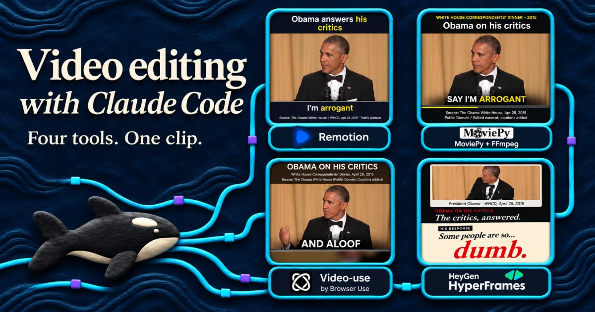
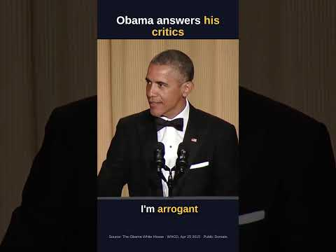
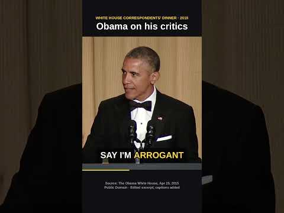
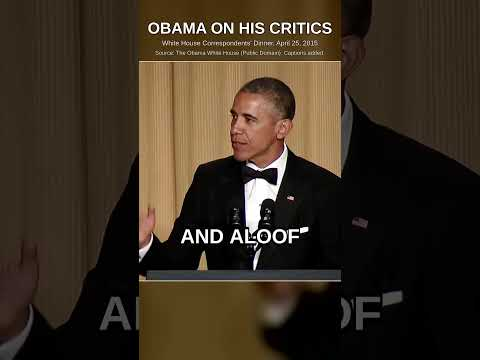
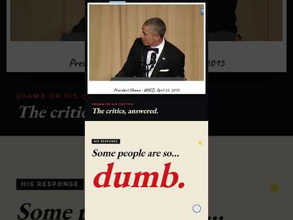
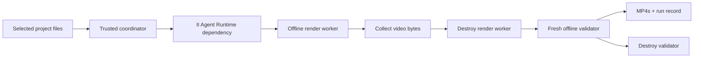

<p align="center"></p>

<h1 align="center">Agentic Video Editing</h1>
<p align="center"><strong>One source clip. Four distinct edits. Every render leaves a record.</strong></p>
<p align="center">
<a href="package.json"></a>
<a href="package.json"></a>
<a href="LICENSE"></a>
<a href="https://discord.gg/DEGQX9RVNn"></a>
</p>
<p align="center"><a href="#render-your-first-shorts"><strong>Run the demo</strong></a> &nbsp; · &nbsp; <a href="https://www.youtube.com/watch?v=V46Ah6IN0oU"><strong>Watch the original</strong></a> &nbsp; · &nbsp; <a href="#compare-the-four-edits"><strong>Compare the edits</strong></a> &nbsp; · &nbsp; <a href="https://github.com/intelligent-iterations/agentic-video-editing/blob/main/docs/experiment.md"><strong>Read the experiment</strong></a></p>
<p align="center"><a href="docs/usage.md">Usage</a> &nbsp; · &nbsp; <a href="CONTRIBUTING.md">Contributing</a> &nbsp; · &nbsp; <a href="SECURITY.md">Security</a> &nbsp; · &nbsp; <a href="https://discord.gg/DEGQX9RVNn">Discord</a></p>

Render agent-authored **Remotion, MoviePy and HyperFrames** projects into validated vertical MP4s. Each render gets a disposable offline worker, explicit resource limits and only the files it needs. Keep the finished shorts, validation results and proof that the workers were cleaned up.

Built on **[II Agent Runtime](https://github.com/intelligent-iterations/ii-agent-runtime)**, imported as a pinned dependency. This repository contains the demo application and editing templates; the runtime remains in its own package.

## Start with the original

This is the exact **20.4-second source excerpt** all four Claude Code setups received. No captions or graphics have been added. Watch it first, then compare how each tool changes the framing, captions and pacing.

<p align="center"><a href="https://www.youtube.com/watch?v=V46Ah6IN0oU"></a><br><a href="https://www.youtube.com/watch?v=V46Ah6IN0oU"><strong>▶ Watch the original clip</strong></a><br><sub>Original input · 20.4 seconds · Not scored</sub></p>

## Compare the four edits

The same clip, instruction, model and worker limits; a different editing setup each time. Click any preview to watch the finished short.

<table>
<tr><td align="center" width="50%"><a href="https://www.youtube.com/watch?v=JA0942rmXDg"></a><br><strong>Remotion</strong><br>Clean captions and a clear opening hook<br><a href="https://www.youtube.com/watch?v=JA0942rmXDg"><strong>▶ Watch short</strong></a></td>
<td align="center" width="50%"><a href="https://www.youtube.com/watch?v=wJW5bEhLzRU"></a><br><strong>MoviePy + FFmpeg</strong><br>The documentation-only control<br><a href="https://www.youtube.com/watch?v=wJW5bEhLzRU"><strong>▶ Watch short</strong></a></td></tr>
<tr><td align="center"><a href="https://www.youtube.com/watch?v=T67Mrx2VCMQ"></a><br><strong>Video-use by Browser Use</strong><br>Conversational talking-head editing<br><a href="https://www.youtube.com/watch?v=T67Mrx2VCMQ"><strong>▶ Watch short</strong></a></td>
<td align="center"><a href="https://www.youtube.com/watch?v=SJDKMSb-i3I"></a><br><strong>HyperFrames</strong><br>HTML video and a talking-head recut skill<br><a href="https://www.youtube.com/watch?v=SJDKMSb-i3I"><strong>▶ Watch short</strong></a></td></tr>
</table>

## What did the judge prefer?

The judge preferred **Remotion's clear hook and readable captions**. MoviePy + FFmpeg placed second but showed too much text. Video-use carried a transcript error into its captions; HyperFrames' opening text was hard to read.

One judge scored the four shorts without knowing which tool made them. Each could earn **25 points: five each for the hook, story and payoff, pacing, faithfulness to the source, and captions and framing**. This is a pilot with one clip and one judge, rather than a claim about audience engagement.

| Editing setup | Blind score / 25 | Agent time | API-equivalent cost |
| --- | ---: | ---: | ---: |
| **Remotion** | **21** | **3.2 min** | **$0.79** |
| MoviePy + FFmpeg | 17 | 3.9 min | $0.73 |
| Video-use | 15 | 7.2 min | $1.45 |
| HyperFrames | 15 | 4.6 min | $1.53 |

The November 15, 2026 experiment used native Claude Code with Claude Opus 5.5. All four finished without human answers. Together: **18.9 minutes, 103 model calls, approximately 5.27 million tokens and $4.50 at API list prices**. The Claude Max plan used incurred **$0 in additional token charges**. [Method and caveats →](docs/experiment.md)

<p align="center"></p>
<p align="center"><sub>One input and brief → four independent editing setups → four shorts. II Agent Runtime keeps the worker conditions consistent.</sub></p>

## Render your first shorts

**Requirements:** Node.js 22.16+, Git, and Docker Desktop, Colima, or Docker Engine with its containerd image store. First-run image builds download the editors and may take several minutes. Budget roughly 4 GB for all three renderer images and the coordinator.

```sh
git clone https://github.com/intelligent-iterations/agentic-video-editing.git
cd agentic-video-editing
npm ci
npm run demo
```

That last command builds what it needs, generates a synthetic source clip, and renders **two 1080 × 1920, six-second shorts with audio and burned-in captions**. No source-footage download or model account is needed.

[**Watch a verified sample output**](media/sample-short.mp4) · [Standalone verification record](proof/standalone-20261116.json)

Try another renderer with the same cuts and captions:

```sh
npm run demo -- --editor remotion
npm run demo -- --editor hyperframes
```

The runnable demo renders prepared projects. The historical Claude Code experiment above includes agent authoring; this repository does not bundle its model gateway or authoring orchestration harness. Bring an agent-authored project to the same renderer boundary.

## Your project. Your limits.

```sh
cp config.example.json config.json
# Set project, inputs, command, output, and resource limits.
npm run demo -- --config config.json
```

A project is just selected files and an explicit render command. Use Python, TypeScript, HTML, or an FFmpeg script. The editor image supplies the tools; the offline worker cannot fetch missing dependencies.

```json
{
  "editor": "moviepy",
  "project": "./my-edit",
  "inputs": ["source.mp4", "render.py"],
  "command": ["python3", "render.py"],
  "output": "./results/my-edit-001",
  "cpu": 2,
  "memoryMiB": 4096,
  "diskGiB": 10,
  "timeoutSeconds": 1800,
  "maxInputMiB": 480,
  "maxOutputMiB": 128,
  "expectedVideos": 2
}
```

Your command creates `out/` and writes exactly `expectedVideos` portrait MP4s, each with audio and no longer than three minutes. Relative paths resolve from the config file. The output directory must be new. On macOS, keep project and output paths in a Docker-shared directory.

[Configuration, image contents, and troubleshooting →](docs/usage.md)

## The render is the product. The proof comes with it.

```text
results/my-edit-001/
├── videos/          finished MP4s
├── run.json         input/output hashes, limits, checks, cleanup
├── videos.tar       verified export archive
├── command.log      bounded render output
└── runtime-state/   empty after successful cleanup
```

**Every delivered video is checked for portrait dimensions, duration, an audio stream, and a complete FFmpeg decode.** The validator runs in a fresh worker and receives only candidate video bytes, so the project cannot replace the validator's imports or forge its proof.

Before extraction, the launcher also requires coordinator success, confirmed
cleanup, and an archive whose size and SHA-256 match the run record.



The coordinator is trusted and owns the Docker connection. Project code receives no Docker socket or model credential. Runtime infrastructure stays in the installed dependency:

```ts
import {
  dockerTofuTarget,
  executionServices,
} from '@intelligent-iterations/ii-agent-runtime/pipeline';
```

[Runtime dependency pin →](package.json) · [Coordinator →](src/run.ts) · [Sample templates →](sample/) · [Historical run evidence →](proof/)

## Try to break the boundary

The included hostile project renders one valid short, plants a fake Python module and forged proof, and leaves a background process rewriting its output:

```sh
npm run demo -- --config test/live/hostile/config.json
```

Only validated MP4 bytes should escape. The renderer and its leftover process are destroyed before validation. The fixture demonstrates an execution and validation boundary, not a claim that arbitrary containers are universally safe.

## Develop

```sh
npm run check          # TypeScript + unit/security checks
npm run build          # compiled CLI + Python assets
npm run test:package   # copied installation, no parent runtime checkout
```

There is no npm-registry release of the runtime dependency assumed here: installation uses a pinned commit from its public GitHub repository. This repo carries no runtime implementation, controller service, model login, or cloud deployment stack.

## Licenses and credits

Application code: [Apache-2.0](LICENSE). Runtime: [II Agent Runtime](https://github.com/intelligent-iterations/ii-agent-runtime). Editors: [MoviePy](https://github.com/Zulko/moviepy), [HyperFrames](https://github.com/heygen-com/hyperframes), and [Remotion](https://www.remotion.dev/docs/license), each under its own license.

The comparison footage comes from the [official Obama White House archive](https://obamawhitehouse.archives.gov/videos/2015/April/04251). Community skill packs are credited in the results; they are not redistributed in this repository. The runnable sample generates its own footage.
